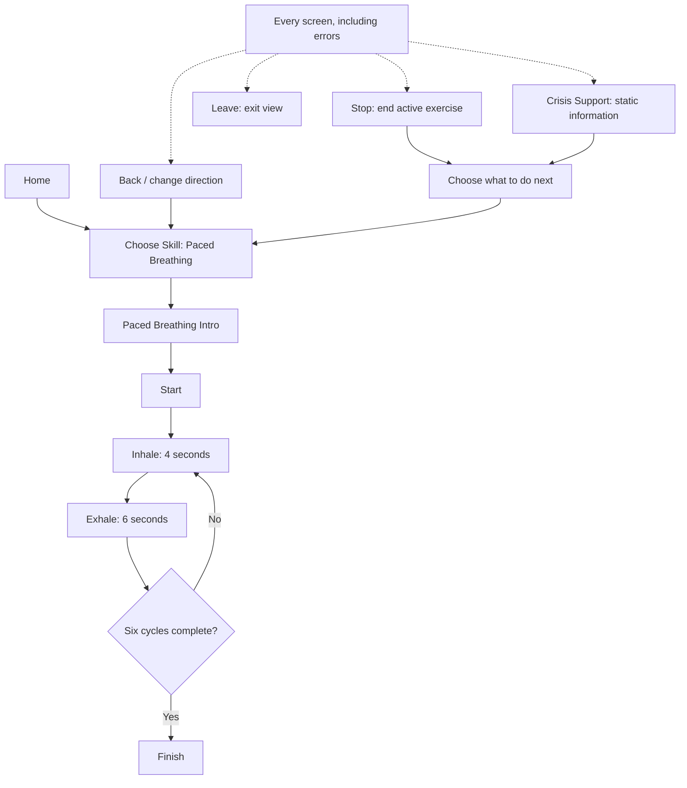

# Assignment 3.1 design draft

This describes a proposed experience. No Assignment 3 application or usability testing is complete.

## A. Project goal

Our goal is a simple, low-stress mental-health skills coursework prototype. The first skill is Paced Breathing 4–6: inhale for 4 seconds, exhale for 6 seconds, and repeat six times. The exercise lasts 60 seconds by design and stays under 90 seconds. This duration is a prototype choice, not a clinical effectiveness claim.

We want one main action or cue per screen, calm wording, and no required disclosure. Stop, Leave, Back/change direction, and Crisis Support remain available as secondary controls.

## B. Fictional use scenario

Alex is a fictional student trying a coursework prototype between study tasks. Alex opens Home, chooses Paced Breathing, reads the introduction, and starts. Alex can finish six cycles or stop early and choose what to do next. This scenario uses no real person's experiences or clinical records.

## C. Main user flow



Home contains the skill choice; a separate selection page is unnecessary while only one skill exists. Stop ends an active timer immediately. Back and Leave also stop an active exercise before navigating. Opening Crisis Support stops the exercise so cues do not continue behind its screen. Returning never restarts it automatically. These are proposed behaviors for later testing.

Leave opens a simple exit view with no active timer. The person can close the tab or return Home. On screens without an active exercise, the Stop location can say “No exercise is running”; Leave and Back remain available. Whether that inactive Stop label is helpful still needs review.

## D. Low-fidelity wireframes

Brackets indicate proposed controls. Each screen has at most one primary action. Inhale and Exhale use a primary cue and advance automatically, without a button press. The secondary control row stays visible and keyboard reachable. Layout and styling still need review.

### Home

```text
Choose a skill

[ Paced Breathing ]                  primary
About 60 seconds. No typing needed.

[Show me fewer options]              optional preference
[Change/reset choice]                secondary
Stop: no exercise running | Leave | Back | Crisis Support
```

### Paced Breathing introduction

```text
Paced Breathing
Inhale for 4 seconds. Exhale for 6 seconds.
Repeat for 6 cycles, about 60 seconds.
You can stop at any time.

[ Start ]                           primary
Stop: no exercise running | Leave | Back | Crisis Support
```

### Inhale

```text
Paced Breathing                      Cycle 1 of 6

          Inhale — 4 seconds
          [timing cue: format undecided]

You can stop at any time.
Stop | Leave | Back / Change skill | Crisis Support
```

### Exhale

```text
Paced Breathing                      Cycle 1 of 6

          Exhale — 6 seconds
          [timing cue: format undecided]

You can stop at any time.
Stop | Leave | Back / Change skill | Crisis Support
```

### Finish

```text
Exercise finished.

[ Back to Home ]                    primary

Stop: no exercise running | Leave | Back | Crisis Support
```

Stopping early instead shows “Exercise stopped.” and “Choose a skill” as its main action. No failure score or penalty is shown.

### Crisis Support information

```text
Crisis Support

This coursework prototype is not a crisis service.
Support information is available without chat.

[ Open verified support resource ]  primary; selection pending
[Resource details and region: to be verified]

Stop: no exercise running | Leave | Back | Crisis Support
```

The resource control is a wireframe placeholder, not an actual support link. Resource selection, regional coverage, exact safety wording, and an update process must be resolved before implementation. No phone number or unverified resource is supplied here. The screen and its entry point use bundled application content without waiting for a backend or model response. An external resource may still need internet access.

## E. Exact example interface copy

Use “Choose a skill,” “Paced Breathing,” “Start,” “Inhale — 4 seconds,” “Exhale — 6 seconds,” “Stop,” “Leave,” “Back,” “Crisis Support,” and “You can stop at any time.” Finish uses “Exercise finished.” Stopping uses “Exercise stopped.”

Possible model-error copy: “That message is unavailable. You can still choose a skill or open Crisis Support.” This is draft copy, not tested wording. Avoid therapeutic promises, diagnosis, scores, streaks, and pressure to continue.

## F. Planned future model role

The deterministic application controls the skill, timing, sequence, navigation, and crisis-support access. No model is needed for the core flow.

Later Assignment 3 parts will include a bounded conversational model. We plan a small conversational interaction that can summarize bounded saved context or provide neutral wording. Relevant context will be limited to the selected skill, the `fewer_options` preference, and a limited session summary or recent fictional conversation records. Exact context and output limits still need to be decided. This feature is not implemented yet, and using it will not be required to start the exercise.

The model must not change timing or sequence, decide whether someone is in crisis, hide or control crisis-support access, diagnose, claim or provide therapy, or invent therapeutic instructions. Generated text must not become timer configuration or executable navigation. The coursework prototype does not monitor the person.

## G. Personalization and user control

“Show me fewer options” is optional. With only one skill, its practical value remains unclear. It must never hide safety or navigation controls. Remembering the last chosen skill may help later if appropriate, but it must not start an exercise automatically. The person can always change or reset the choice.

## H. Unresolved design questions

- Should the cue use animation, text, or both?
- How should reduced-motion users follow timing without excessive screen-reader announcements?
- What minimal preference data should be saved, and for how long?
- Which verified crisis-support resource and region should the final prototype use?
- What should happen if a model request fails? The core flow and safety access must remain available; detailed fallback behavior needs review.
- What should happen if the browser is backgrounded or the device sleeps during the timer?
- Should refresh end the exercise or offer an explicit restart?
- Is an inactive Stop label on non-exercise screens useful or confusing?

These questions have not been researched or tested yet.
